# Files

> **Licence status: pending.** No licence has been granted for this repository
> yet. Apache-2.0 is the *proposed* licence for CLP Studio's own code only. Its
> text is in [`LICENSE.pending-review.md`](LICENSE.pending-review.md) and is
> **not in force**. The app also contains third-party parts under other
> licences, including one that is not open source (Junrar, UnRAR licence). See
> [Licensing](#licensing).

**Files** is a file manager for Android phones, made by CLP Studio. It lets you
browse, search, open and organise everything on your phone in one place:
photos, videos, music, documents, archives and apps. It also has a Bin for
deleted files, an encrypted Vault and an optional app lock. **Files works
completely offline.** It has no internet permission, so it cannot send your
files or any other data anywhere.

Package `com.clpstudio.filesmanager` · Android 8.0 or newer (API 26) · ARM
phones (64-bit and 32-bit).

## Screenshots

| Home | Home (dark theme) | A folder |
|:---:|:---:|:---:|
| 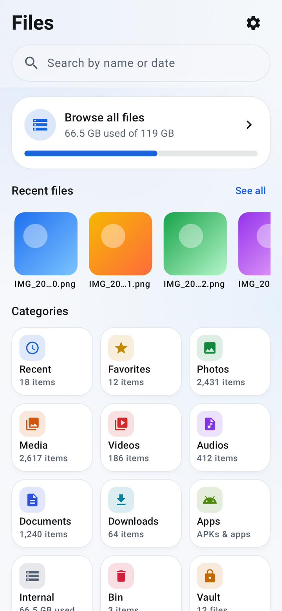 | 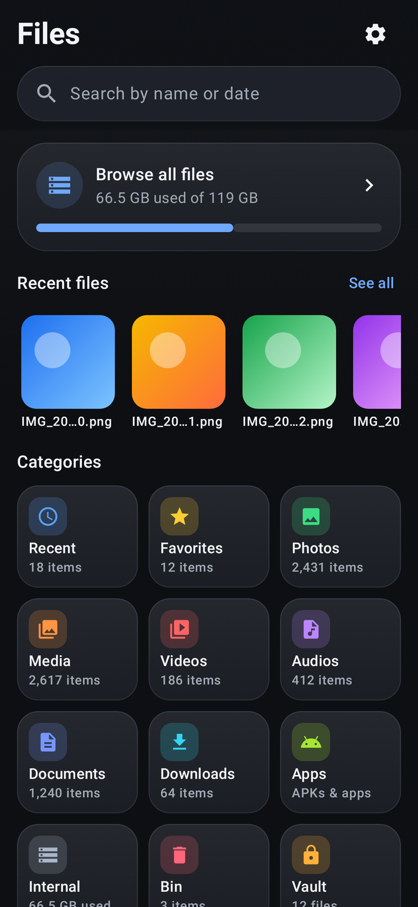 | 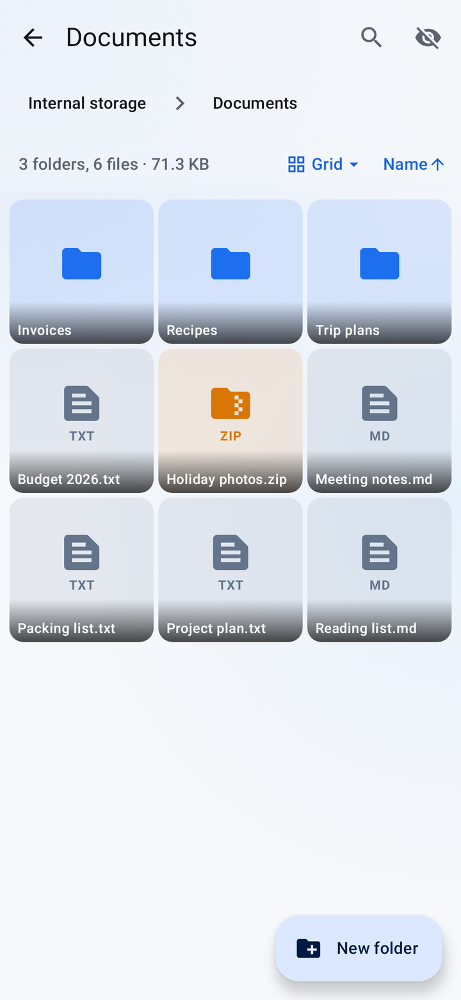 |
| **Search** | **Inside a ZIP archive** | **Word document** |
| 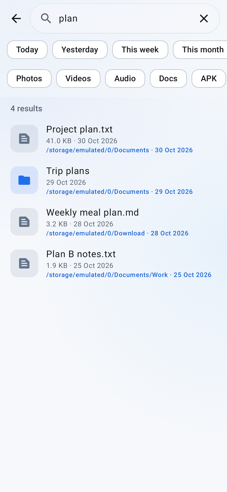 | 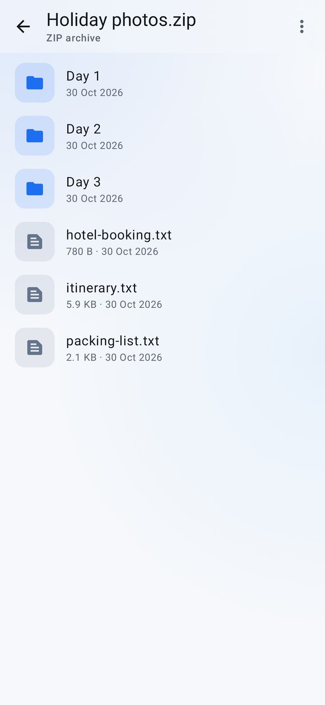 | 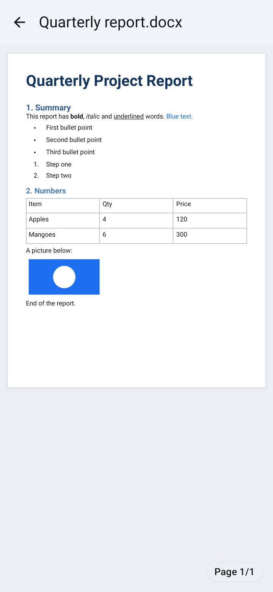 |
| **Music player** | **Vault setup** | **App lock** |
| 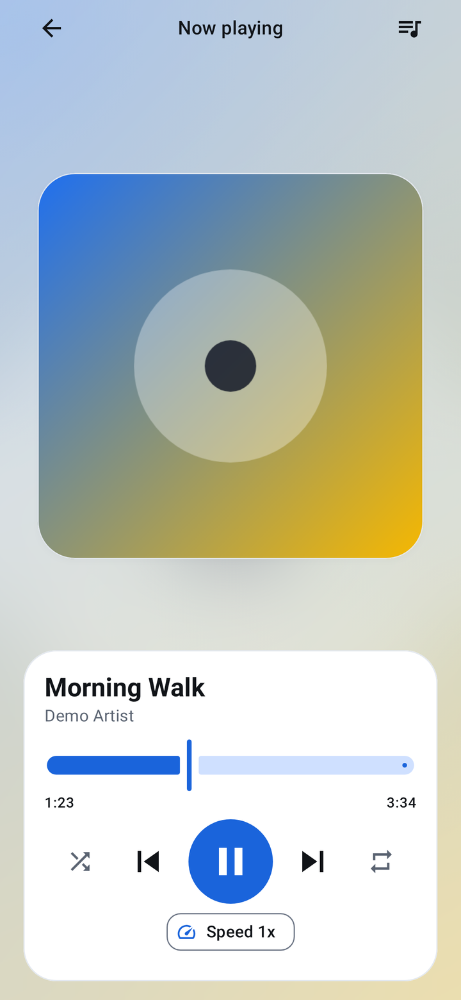 | 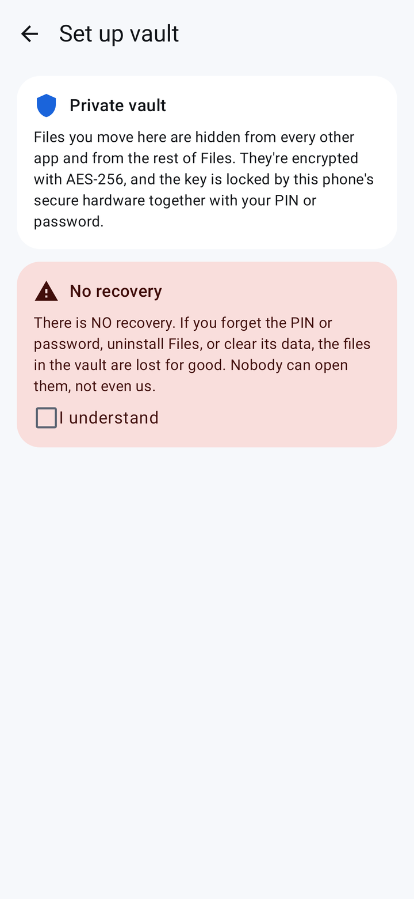 | 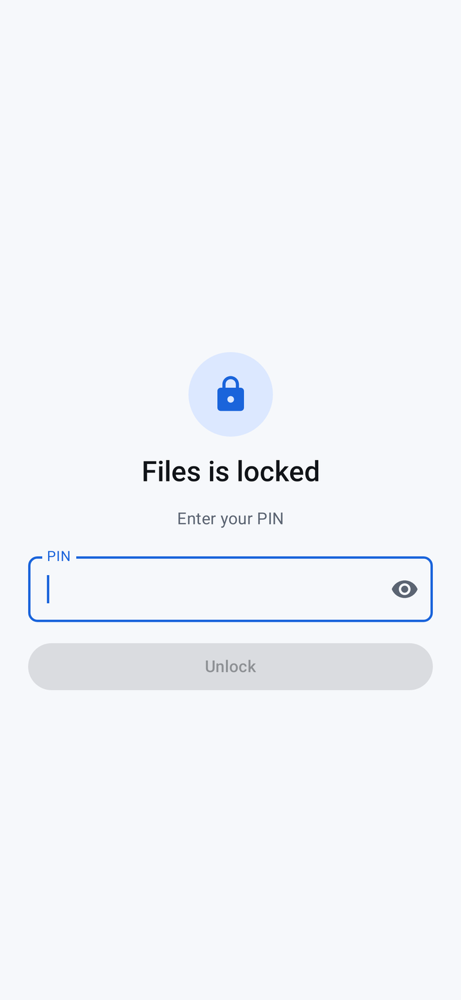 |
| **Settings** | **Open-source licences** | |
| 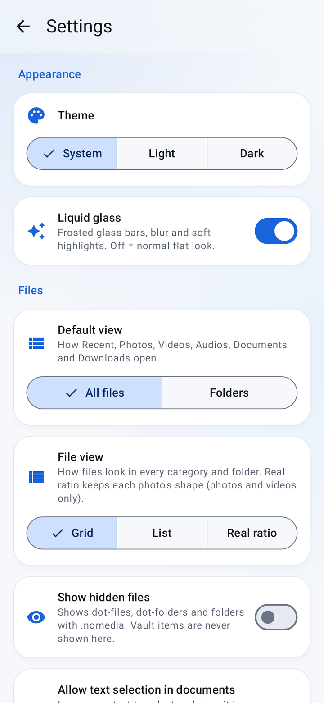 | 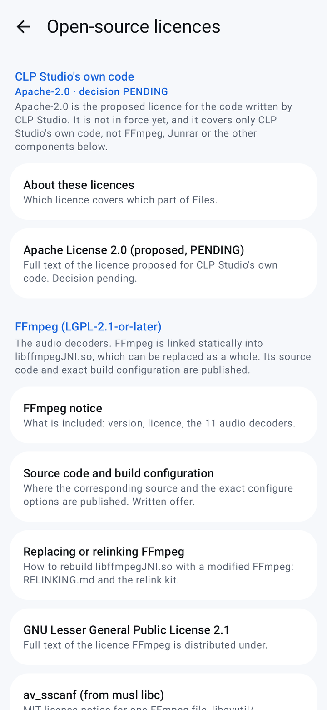 | |

The screenshots are rendered from the app's real screens by the test suite
(`ReadmeScreenshotTest`), with made-up file names. They are not photos of a
phone, so small details (such as the status bar) can look different on a
device.

## Features

| Area | What you can do |
|---|---|
| Home | Recent, Favorites, Photos, Media, Videos, Audios, Documents, Downloads, Apps, Internal storage, Bin, Hidden files and Vault. Categories are grouped by folder, with real thumbnails. |
| Browse | Copy, move, rename, delete to the Bin, share, new folder, multi-select, sort, grid or list, SD cards, show hidden files. |
| Search | By name and by date (for example `31/10/2026`, `Oct 2026`, `yesterday`), with date chips and type filters. |
| Viewers | Photos, video (with gestures, subtitles and picture-in-picture), music (background playback, lock-screen controls, queue), PDF (including password-protected PDFs), text and code, Markdown, Word/Excel/PowerPoint previews, EPUB, APK details, and Photoshop/Illustrator/CorelDRAW/AutoCAD previews. |
| Archives | Open ZIP, 7z and RAR (RAR4) files without extracting. Extract all or some files. Create ZIP files, with or without a password. RAR5 files are not supported. |
| Apps | APK files on your phone, your installed apps and system apps. Install an APK, uninstall an app, see app sizes and apps you have not used for a while. |
| Bin | Deleted files are kept for 30 days, then removed automatically. Restore, delete forever or empty the Bin. |
| Vault | Move private files into an encrypted vault, protected by a PIN or password (and optionally your fingerprint). |
| App lock | Optional PIN or password (and optional fingerprint) to open the app. |
| Other apps | "Open with Files" for any file type. Files can also be chosen as the file picker when another app asks you to pick a file. |
| Look | Light, dark or follow the system. A "liquid glass" look or a plain Material look. |

## Permissions the app requests, and why

These are all the permissions in the release APK. You can check them yourself
with `aapt2 dump badging <apk>`.

| Permission | Why Files needs it |
|---|---|
| `READ_EXTERNAL_STORAGE` (only up to Android 12, `maxSdkVersion` 32) | To read your files on older Android versions. |
| `WRITE_EXTERNAL_STORAGE` (only up to Android 10, `maxSdkVersion` 29) | To copy, move, rename and delete files on Android 8 to 10. |
| `MANAGE_EXTERNAL_STORAGE` ("All files access", Android 11 and newer) | A file manager has to see and change every file and folder, not only photos and videos. Android asks you to allow this on a separate system screen; the app shows a page that explains it first. |
| `QUERY_ALL_PACKAGES` | To list your installed apps on the Apps screen and show their names and icons. |
| `REQUEST_INSTALL_PACKAGES` | To install an APK file when you tap it. Android always shows its own install prompt, which you must confirm. |
| `REQUEST_DELETE_PACKAGES` | To start uninstalling an app when you ask. Android always shows its own confirmation. |
| `POST_NOTIFICATIONS` | To show the playback notification (play/pause, next) while music or a video's sound plays in the background. Asked on Android 13 and newer. |
| `FOREGROUND_SERVICE` | To keep playing music or a video's sound when you leave the app. |
| `FOREGROUND_SERVICE_MEDIA_PLAYBACK` | Required by Android 14 and newer for that background playback. |
| `WAKE_LOCK` | Keeps the phone's processor awake while audio plays with the screen off, so playback doesn't stop. Android's WorkManager library (which runs the Bin's daily clean-up) also uses it. |
| `PACKAGE_USAGE_STATS` ("Usage access") | Only for the storage screens: the size of each app, and which apps you have not used for a while. It does nothing until you turn on Usage access for Files in Android's settings. |
| `USE_BIOMETRIC` | Only if you choose to unlock the app lock or the Vault with your fingerprint. |
| `RECEIVE_BOOT_COMPLETED` | Added by Android's WorkManager library, which runs the Bin's daily clean-up (removing items older than 30 days). It lets that scheduled job continue after the phone restarts. |
| `com.clpstudio.filesmanager.DYNAMIC_RECEIVER_NOT_EXPORTED_PERMISSION` | Added automatically by the AndroidX core library. It is private to Files and protects the app's internal broadcasts from other apps. You will not see it in your phone's settings. |

**There is no `INTERNET` permission.** The app's manifest explicitly removes
`INTERNET`, `ACCESS_NETWORK_STATE` and `ACCESS_WIFI_STATE`, even if a library
asks for them, and the build checks that the final APK has none. Without
internet permission, Android does not let the app open any network
connection, so **Files cannot upload, sync or send your data anywhere.**

## How it works

Files is a native Android app written in Kotlin with Jetpack Compose and
Material 3.

| Part | What it does |
|---|---|
| `app/` | The whole app: screens (`ui/`), file and storage logic (`data/`), viewers (`viewer/`), playback (`playback/`), the Vault (`vault/`), the app lock (`security/`) and the Bin clean-up job (`work/`). |
| `decoder-ffmpeg/` | An FFmpeg audio decoder for formats many phones can't play (AC-3, E-AC-3, DTS, TrueHD/MLP and others). It is built in this repository from AndroidX Media 1.8.0's code and FFmpeg 6.0 source, with 11 audio decoders only. The phone's own decoders are always tried first. |
| Playback | AndroidX Media3 (ExoPlayer) for video and music, with a media session for the notification and lock-screen controls. |
| Archives | Zip4j (ZIP, including AES passwords), Apache Commons Compress and XZ (7z, tar, gz) and Junrar (RAR4). |
| PDF | Android's built-in `PdfRenderer` draws the pages. PdfBox-Android is used for password-protected PDFs and for adding a password. |
| Thumbnails and images | Coil (photos, video frames, GIF, SVG). |
| Settings and background jobs | Jetpack DataStore for settings, WorkManager for the Bin's daily clean-up. |

All of these run on the phone. None of them uses the network.

## How your data is handled

### Everything stays on your phone

- Files has no internet permission, so it cannot send anything off the phone.
- There are no analytics, no ads, no accounts, no sign-in and no tracking. The
  app does not contain any analytics, advertising or crash-upload library.
- A file only leaves the app when **you** share it, for example with the Share
  button. Then Android passes that one file to the app you choose.
- When another app asks you to pick a file and you choose Files, that app can
  read only the file you picked. Files never lets other apps change your files
  this way, and it never shows them the Vault or the Bin.
- Crash reports and logs are saved only on your phone (Settings > Crash
  reports, Settings > Logs). They never leave the phone unless you tap Share or
  Copy yourself. Logs can contain file names and folder paths, but never file
  contents, Vault data or PINs. Check them before you post them anywhere.
- App backup is turned off. Android does not copy the app's data to the cloud
  or to a new phone.

### The Vault

The Vault is off until you set it up. When you move a file into it:

1. The file is encrypted with **AES-256-GCM**, in 64 KB pieces, so videos can
   be played and seeked straight from the encrypted file. Each file gets its
   own key. Any change to an encrypted file is detected, and the app then
   refuses to show it.
2. The file's name, original folder, size and dates are encrypted too. While the Vault is
   locked, only the number of files and the space they use can be seen.
3. The app decrypts the new copy and checks it against the original. Only
   then is the original file deleted. (This is a normal delete. Like any
   delete on phone storage, it is not a guaranteed secure wipe.)

How the key is protected:

- A random 256-bit master key encrypts your files.
- That master key is locked with a key made from your PIN or password
  (PBKDF2-HMAC-SHA256, 200,000 rounds, random salt).
- The result is locked again with an AES-256 key kept inside the phone's
  **Android Keystore** hardware (the StrongBox security chip if the phone has
  one, otherwise the secure area of the processor). That key cannot be copied
  out of the phone.
- So the Vault opens only with **both** your PIN/password **and** this phone.
- If you turn on fingerprint unlock, a second copy of the master key is locked
  with a separate Keystore key that works only after a successful strong
  fingerprint check. Adding a new fingerprint to the phone disables it.
- Wrong tries are limited. After too many, you have to wait, and the wait
  grows with each lockout.

Opening Vault files: photos, videos, music, PDFs and text are read straight
from the encrypted file. Some other types (such as Word files, archives or
EPUBs) need a real file for their viewer. These are decrypted into the app's
private storage and overwritten and deleted when you close the viewer, when the
Vault locks, and at the next app start. Screenshots and screen recording are
blocked on Vault screens.

**There is no recovery.** If you forget your PIN or password, clear the app's
data or uninstall the app, the files in the Vault are lost for good. Nobody,
including CLP Studio, can open them. Move files out of the Vault before you
uninstall or change phones.

"Hide" (Hidden files) is different from the Vault: it only moves a file into a
`.hidden` folder that galleries skip. Hidden files are **not** encrypted.

### The app lock

The app lock is optional (Settings > App lock). It uses a PIN or password, and
optionally your fingerprint. It is separate from the Vault's PIN. Only a
PBKDF2 check value of your PIN is stored, never the PIN itself.

### The Bin

- When you delete a file, Files moves it to its Bin (on an SD card, to a Bin
  on that same card). It is kept for **30 days**, then removed automatically
  by a daily background job.
- You can restore a file, delete it forever or empty the Bin at any time.
- The Bin is in the app's own folder (`Android/data/com.clpstudio.filesmanager/files/bin`).
  **Android deletes this folder when you uninstall Files, so anything still in
  the Bin is lost.** Restore what you need first.
- The Bin screen also shows files that other apps moved to Android's own
  trash (Android 11 and newer).

### What is stored where

| Data | Where | Removed when you uninstall? |
|---|---|---|
| Your own files and folders | Your phone's storage or SD card, where they already are | No. Files does not touch them on uninstall. |
| Files in the Bin | The app's folder on the phone (or on the SD card) | Yes |
| Vault files and the Vault's key file | The app's private storage (not backed up) | Yes. The Keystore key is deleted too, so the Vault can never be opened again. |
| Settings, favorites, playlists, app lock check value | The app's private storage | Yes |
| Crash reports and logs | The app's private storage | Yes |
| Thumbnails and temporary copies (for example a file opened from WhatsApp, or a file opened from inside a ZIP) | The app's cache | Yes. Android may also clear the cache when storage is low. |
| Hidden files | A `.hidden` folder next to the original file | No (they are normal files) |
| Files you extracted, or moved out of the Vault | The folder you chose | No |

"Clear storage" for Files in Android's settings removes the same things as an
uninstall, except your own files.

## Install

Official APKs will be published on the
[Releases page](https://github.com/clpsudio/filesmanager/releases) once releases
are approved. There are no public releases yet.

The APK is for ARM phones (almost all Android phones). It does not install on
x86 emulators.

Official builds are signed by CLP Studio. Before installing an APK you
downloaded, you can check its signature:

```
apksigner verify --print-certs Files.apk
```

It should show:

| | |
|---|---|
| Certificate | `CN=CLP Studio Files, O=CLP Studio, C=IN` |
| SHA-256 | `febc1f7c94c20f90ba40ba1cb1d58c9c6209ee430b98a60a479852e99e8b353e` |
| SHA-1 | `23:49:6F:AD:F2:0B:49:72:3D:F3:EF:92:DA:96:27:80:DE:41:CF:5B` |

An APK signed with any other key is not an official CLP Studio build.

## Build from source

You need:

- Linux or macOS (on Windows, use WSL), with `bash`, `make`, `curl` and `tar`;
- JDK 17 or newer (CI uses Temurin 21);
- the Android SDK with platform `android-36`, **NDK `26.1.10909125` (r26b)** and
  **CMake `3.22.1`**;
- internet access for the first build (Gradle, libraries and the FFmpeg
  source).

Steps from a fresh clone:

```
# 1. SDK parts (once)
sdkmanager "platforms;android-36" "ndk;26.1.10909125" "cmake;3.22.1"
export ANDROID_HOME=/path/to/android/sdk      # or put sdk.dir=... in local.properties

# 2. Get the code
git clone https://github.com/clpsudio/filesmanager.git
cd filesmanager

# 3. Test, check and build
./gradlew :app:testDebugUnitTest :app:lintDebug :decoder-ffmpeg:lintDebug :app:assembleRelease
```

During the first build, Gradle runs `scripts/ffmpeg/build-ffmpeg.sh`. It
downloads FFmpeg at the pinned commit, checks its sha256 and builds it with the
pinned NDK (about a minute on a fast machine). Later builds reuse the result.
All pinned versions are in `scripts/ffmpeg/versions.env`.

The APK is written to `app/build/outputs/apk/release/`. Without signing
settings it is **unsigned** (`app-release-unsigned.apk`); sign it with your own
key (for example with `apksigner`) before installing. Release signing reads
`ANDROID_KEYSTORE_PATH`, `ANDROID_KEYSTORE_PASSWORD`, `ANDROID_KEY_ALIAS` and
`ANDROID_KEY_PASSWORD` from the environment. Never commit a keystore or a
password. For a quick test, `./gradlew :app:assembleDebug` builds a debug APK
signed with your local debug key.

Optional (Linux only): `scripts/ffmpeg/build-host-jni-for-tests.sh` builds a
copy of the decoder for your computer, so `./gradlew :decoder-ffmpeg:testDebugUnitTest`
decodes real audio samples through FFmpeg. Without it those tests are skipped.

Extra checks (CI runs them too):

| Script | What it checks |
|---|---|
| `scripts/ci/check-no-prebuilt-native.sh` | No prebuilt native library (`.so`, `.a`, `.o` or similar) is committed, so FFmpeg is always built from source. |
| `scripts/ci/check-apk-r8.py` | After shrinking (R8), the release APK still contains the decoder, archive, PDF and player code. |
| `scripts/test-fixtures/make-fresh-archives.sh` | Rebuilds the test archives (RAR4/RAR5/ZIP/7z/tar.gz). |
| `scripts/test-fixtures/make-dwg-fixtures.py` | Rebuilds the two small AutoCAD test files. |

Screenshots for this README:
`./gradlew :app:testDebugUnitTest --tests '*ReadmeScreenshotTest*' -Proborazzi.test.record=true`,
then copy `app/build/readme-screenshots/*.png` to `docs/screenshots/`.

Builds are reproducible: with the pinned NDK and CMake, two clean builds give
byte-identical `libffmpegJNI.so` files. See `decoder-ffmpeg/UPSTREAM.md` and
[`RELINKING.md`](RELINKING.md).

## Using and contributing to this repository

| You want to… | Do this |
|---|---|
| Report a bug | Open an [issue](https://github.com/clpsudio/filesmanager/issues) with your Android version, phone model, app version (Settings) and the steps. Remove private file names from any log you paste. |
| Suggest a feature | Open an issue first, so the idea can be discussed before anyone writes code. |
| Send a fix or feature | Fork the repository, make a branch, and open a pull request. Read [`CONTRIBUTING.md`](CONTRIBUTING.md) first. Tests and lint must pass (CI runs them on every pull request, without any signing keys). |
| Report a security problem | **Don't** open a public issue. Follow [`SECURITY.md`](SECURITY.md) to report it privately. |
| Build your own version | Follow [Build from source](#build-from-source). A version you publish as a separate app must use its own name, icon and package name, and must follow the third-party licences below. |

Project rules, in short: the app stays offline (no network code, analytics,
ads or upload of crash data), no secrets in the repository, and no new Android
permission without a clear reason.

## Licensing

> **Status: pending.** The licence decisions below are not final. This section
> will be updated when they are made.

The APK is made of parts with **different licences**. Not everything in it is
open source, so the app as a whole must not be described as "open source" or
as "Apache-2.0 licensed".

| Part | Licence | Status |
|---|---|---|
| CLP Studio's own code (Copyright 2026 CLP Studio) | Apache License 2.0 (proposed) | **Pending.** Text in [`LICENSE.pending-review.md`](LICENSE.pending-review.md), not in force. Until it is confirmed, no licence is granted for this code. |
| FFmpeg 6.0 (audio decoders inside `libffmpegJNI.so`) | LGPL-2.1-or-later (one file, musl's `av_sscanf`, is MIT) | Built without any GPL, "version3" or non-free parts. See below. |
| Junrar 7.5.5 (opens RAR4 archives) | UnRAR licence | **Not an open-source licence.** **Pending:** CLP Studio may replace Junrar with an open-source RAR reader. See below. |
| AndroidX, Media3 (incl. its FFmpeg decoder Java/JNI code), Kotlin, Compose, Coil, Zip4j, Commons Compress, PdfBox-Android and others | Mostly Apache-2.0, some MIT, BSD or 0BSD | Listed with versions in [`THIRD_PARTY_LICENSES.md`](THIRD_PARTY_LICENSES.md). |

Every licence text and notice is also inside the app, under
**Settings > Open-source licences**.

### FFmpeg (LGPL-2.1-or-later)

If you distribute an APK, the LGPL requires you to:

- include the FFmpeg notice and the LGPL-2.1 text (`licenses/FFMPEG-NOTICE.txt`,
  `licenses/LGPL-2.1.txt`; both are shown in the app);
- make the matching FFmpeg source available. `scripts/ffmpeg/make-corresponding-source.sh`
  builds the "corresponding source" bundle (source tarball, exact build
  configuration and scripts). See `licenses/FFMPEG-SOURCE.txt`;
- let users replace the FFmpeg library. FFmpeg is linked statically into
  `libffmpegJNI.so`, which can be rebuilt and replaced as a whole. See
  [`RELINKING.md`](RELINKING.md) and `licenses/FFMPEG-RELINKING.txt`.

### Junrar (UnRAR licence) — decision pending

> This part may change. CLP Studio is deciding whether to keep Junrar or to
> replace it with an open-source alternative (for example libarchive). Until
> then, the current state is:

- Junrar is used only to open RAR4 archives.
- Its UnRAR licence allows free use and redistribution, but its code **may not
  be used to re-create the RAR compression algorithm**, and that restriction
  must be passed on.
- The UnRAR licence is not an OSI-approved open-source licence, and it is not
  compatible with the GPL.
- Full text: `licenses/UnRAR-junrar-7.5.5.txt`, and section 3.2 of
  [`THIRD_PARTY_LICENSES.md`](THIRD_PARTY_LICENSES.md).

### Names and logos

The proposed Apache-2.0 licence would not give any rights to the CLP Studio
name, the Files name as used by CLP Studio, or the logo and icon.

## Credits

Files is made by **CLP Studio**. It is built on the work of many open-source
projects, including:

- [Android Jetpack / AndroidX](https://developer.android.com/jetpack), Jetpack
  Compose, Material 3 and [Media3](https://github.com/androidx/media) (Google,
  Apache-2.0)
- [FFmpeg](https://ffmpeg.org) (LGPL-2.1-or-later)
- [Kotlin](https://kotlinlang.org) and kotlinx.coroutines (JetBrains, Apache-2.0)
- [Coil](https://github.com/coil-kt/coil) (Apache-2.0)
- [Zip4j](https://github.com/srikanth-lingala/zip4j) (Apache-2.0)
- [Apache Commons Compress](https://commons.apache.org/proper/commons-compress/) (Apache-2.0)
- [XZ for Java](https://tukaani.org/xz/java.html) (0BSD)
- [Junrar](https://github.com/junrar/junrar) (UnRAR licence)
- [PdfBox-Android](https://github.com/TomRoush/PdfBox-Android) (Apache-2.0)
- [Haze](https://github.com/chrisbanes/haze) (Apache-2.0)

The full list, with versions and licences, is in
[`THIRD_PARTY_LICENSES.md`](THIRD_PARTY_LICENSES.md).
